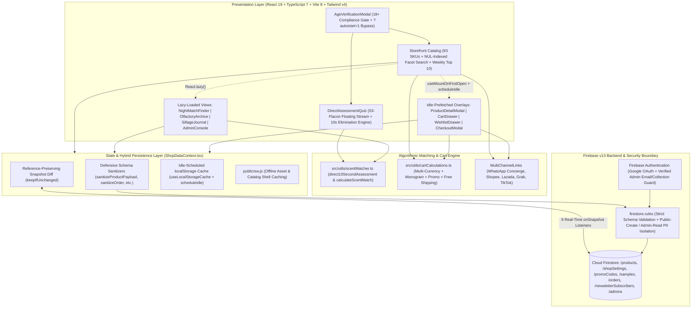

# DLAB Night Match — Haute Parfumerie & Nocturnal Extraits E-Commerce Platform

## 1. Project Overview & Problem Solved

**DLAB Night Match (`dlab-night-match`)** is a luxury headless e-commerce Progressive Web Application (PWA) and bespoke olfactory diagnostic platform engineered for **DLAB Atelier**, specializing in 35% pure nocturnal *Extraits de Parfum*, solid aromatics, and custom hardware accessories across 93 verified SKUs.

### The Core Business Problem
High-concentration artisanal perfumery and age-gated nocturnal formulations face three distinct digital commerce challenges:
1. **Sensory Decision Paralysis Across a 93-SKU Archive**: Unlike commodity retail, fragrance patrons cannot physically sample scents through a screen. Browsing 93 specialized formulations (`47x 10ml Pocket Flacons`, `19x 30ml Atelier Flacons`, `10x 40ml Heavy Crystal Editions`, `1x Solid Balm`, and `16x Leakproof/Mickey-Cap Accessories`) without guided olfactory profiling leads to high bounce rates and choice overload.
2. **Multi-Channel & Cross-Border Fulfillment Friction**: Patrons across Malaysia, Singapore, Europe, the UK, and Japan purchase through diverse channels—ranging from direct commissioned WhatsApp concierge orders and same-day Grab Express dispatch to regional marketplaces (Shopee MY, Lazada MY, TikTok Shop)—requiring multi-currency pricing (`USD`, `EUR`, `GBP`, `JPY`), custom 3-character flacon monogramming (`+$20`), complimentary 2ml sample vial selection, and dynamic free-shipping threshold calculation.
3. **Real-Time Cloud Inventory vs. Zero-Latency Storefront Performance**: Synchronizing 6 live Cloud Firestore collections (`products`, `shopSettings`, `promoCodes`, `samples`, `orders`, `newsletterSubscribers`) can trigger redundant React re-renders and main-thread `localStorage` serialization bottlenecks on mobile devices, while strict schema and PII boundaries must be enforced so patron order records remain write-only for anonymous guests and readable only by verified atelier administrators.

### The Solution
DLAB Night Match pairs an obsidian-and-gold editorial storefront (`#0F0E0D` / `#D4AF37`) with dual algorithmic scent-matching engines and a hybrid local-first/Firestore real-time backend:
- **10-Second Direct Assessment ("The Elimination Game") & 4-Step Night Match Engine**: Guides patrons to an immediate in-stock recommendation (`direct10SecondAssessment`) or a multi-dimensional affinity ranking (`calculateScentMatch`) across atmosphere, scent family, sillage projection, and note accords.
- **5-Tab Luxury Atelier Experience**: Combines the **93-SKU Catalog & Weekly Top 10 Leaderboard**, **Night Match Diagnostic Consultation**, **Olfactory Archive** (raw ingredient provenance & maceration metrics), **Sillage Journal** (editorial essays), and a Google-Auth-protected **Admin Console** for live CRUD over products, promo codes, sample vials, shop settings, and patron orders.
- **Multi-Channel Deep-Linking & Commissioned Checkout**: Generates structured multi-item WhatsApp concierge invoices (`generateMultiItemWhatsAppLink`) alongside direct marketplace links (`Shopee`, `Lazada`, `Grab Delivery`, `TikTok`, `Webstore`) while persisting commissioned orders directly to Cloud Firestore.

---

## 2. Tech Stack & Architecture Choices

### System Architecture Diagram



### Technology Stack Table

| Layer | Technology | Version | Architectural Role & Justification |
| :--- | :--- | :--- | :--- |
| **UI Runtime** | React 19 + TypeScript | `^19.0.1` / `^7.0.2` | Concurrent rendering (`useDeferredValue` for lag-free search across 93 SKUs), `React.lazy` view splitting, and strict type definitions. |
| **Build & Bundler** | Vite 8 + `@tailwindcss/vite` | `^8.3.0` / `^4.3.3` | Rollup `manualChunks` isolating `firebase-vendor`, `react-vendor`, and `catalog-data` (`src/data/products.ts`) for fast initial paint. |
| **Cloud Backend & Auth** | Firebase Firestore & Auth | `^13.1.0` | Real-time `onSnapshot` synchronization across 6 collections with Google OAuth admin authentication and atomic `writeBatch` seeding. |
| **Security & Governance** | Cloud Firestore Security Rules | `rules_version = '2'` | Enforces 398 lines of field-level type, length, enum, and regex constraints (`firebase-blueprint.json`) with PII isolation on `/orders` and `/newsletterSubscribers`. |
| **AI & Capabilities** | `@google/genai` | `^2.4.0` | Configured for AI-assisted olfactory copywriting and diagnostic consultation extensions. |
| **Automated QA** | Node.js Native Test Runner | `node --test` | Deterministic unit verification (`tests/logic.test.mjs`) covering 93-SKU integrity, scent matching, cart math, and multi-channel URL builders. |

---

## 3. Key Features & UI Implementation

### 1. "The Elimination Game" 10-Second Direct Assessment & 53-Flacon Live Stream (`src/components/DirectAssessmentQuiz.tsx`)
- **4-Column Animated 53-Flacon Backdrop**: Renders `LIVE_STREAM_FLACONS` across 4 vertical CSS-keyframe floating columns (`animate-float-stream-slow`, `animate-float-stream-med`, `animate-float-stream-fast`) masked with top and bottom obsidian gradients (`#0F0E0D`).
- **3-Step Instant Olfactory Triage**: Patrons select their operational intensity (`Mild`, `Strong`, `Intense`) and desired nocturnal aura (`High-energy`, `Sensual`, `Relaxing`, `Velvet Focus`), pick a flacon volume (`10ml`, `30ml`, `40ml`), and receive a single high-confidence in-stock recommendation (`>= 90%` match confidence) with 1-tap bag addition or direct multi-channel ordering.

### 2. Multi-Faceted 93-SKU Catalog, Synergy Badges & Weekly Top 10 Leaderboard (`src/App.tsx`, `src/components/LeaderboardSection.tsx`)
- **6-Dimensional Filtering & Sorting**: Filters 93 products instantaneously across Category (`All`, `10ml`, `30ml`, `40ml`, `solid`, `accessory`), Intensity (`Mild`, `Strong`, `Intense`), Synergy Role (`Ascendant ▲`, `Receptive ▼`, `Universal ◆`), Experience, and Sillage (`Intimate`, `Radiant`, `Heavy`), with sorting by Featured, Price, Longevity Hours, or Sales Rank.
- **Weekly Top 10 Telemetry Leaderboard**: Visualizes verified patron demand share (`WEEKLY_TOP_10_METRICS`, led by `NO.06 C4 Nocturne` at `22.7%` share) with trending delta badges and instant quick-view triggers.
- **Custom Flacon Monogramming & Complimentary Samples (`src/components/CartDrawer.tsx`)**: Supports 3-character custom gold-leaf flacon engraving (`+$20/unit`), selection of up to 2 complimentary 2ml sample vials (`COMPLIMENTARY_SAMPLES`), Obsidian Coffret gift packaging, and live promo code calculation (`NOCTURNE10`, `HAUTE15`, `VIPATELIER`).

### 3. Real-Time Cloud Admin Console (`src/components/AdminConsole.tsx`)
- **Live Storefront Governance**: Authenticated administrators (`aliakhmadf@gmail.com` or `/admins/{uid}`) can create, edit, or delete products, toggle stock availability, update global shipping thresholds and announcement banners (`shopSettings/global`), manage promo codes and sample vials, and transition patron order statuses (`pending` -> `dispatched` -> `completed`).

---

## 4. Technical Challenges Overcome

### Challenge 1: Zero-Jank Hydration, DeferredOverlay Mounting & Idle-Scheduled `localStorage` Persistence
**Problem**: E-commerce storefronts with rich modals (`ProductDetailModal`, `CartDrawer`, `WishlistDrawer`, `CheckoutModal`) and real-time Firestore listeners often suffer from two performance traps:
1. Mounting all hidden modals on initial load bloats the main bundle and slows down First Contentful Paint (FCP), whereas unmounting them on close destroys in-progress user state (such as partially completed checkout forms).
2. Re-serializing a 93-product catalog (`dlab_admin_products_v2_93`) synchronously to `localStorage` on every Firestore snapshot emission blocks the main thread and triggers cascading React re-renders when Firestore echoes back local writes.

**Solution**:
1. In [`src/App.tsx`](file:///C:/Users/AL_AAF/Project/E-commernce-site-Dlab/E-commernce-site-Dlab/src/App.tsx#L14-L38), we engineered `useMountOnFirstOpen(active)` paired with `scheduleIdle` chunk prefetching ([`src/utils/scheduleIdle.ts`](file:///C:/Users/AL_AAF/Project/E-commernce-site-Dlab/E-commernce-site-Dlab/src/utils/scheduleIdle.ts#L7-L15)). Overlays are omitted from the initial React tree, prefetched during browser idle time (`requestIdleCallback`), mounted on first open, and kept alive thereafter to preserve form state.
2. In [`src/context/ShopDataContext.tsx`](file:///C:/Users/AL_AAF/Project/E-commernce-site-Dlab/E-commernce-site-Dlab/src/context/ShopDataContext.tsx#L246-L280), we implemented `keepIfUnchanged(prev, next)` to preserve object reference identity when Firestore snapshots match current state, and `useLocalStorageCache(key, value)` to coalesce and defer JSON serialization off the critical render path:

```tsx
// File: C:\Users\AL_AAF\Project\E-commernce-site-Dlab\E-commernce-site-Dlab\src\context\ShopDataContext.tsx (Lines 246-280)
function keepIfUnchanged<T>(prev: T, next: T): T {
  try {
    return JSON.stringify(prev) === JSON.stringify(next) ? prev : next;
  } catch {
    return next;
  }
}

function useLocalStorageCache<T>(key: string, value: T): void {
  const lastWrittenRef = useRef<string | null>(null);

  useEffect(() => {
    return scheduleIdle(() => {
      try {
        const serialized = JSON.stringify(value);
        if (serialized === lastWrittenRef.current) return;
        if (lastWrittenRef.current === null && localStorage.getItem(key) === serialized) {
          lastWrittenRef.current = serialized;
          return;
        }
        localStorage.setItem(key, serialized);
        lastWrittenRef.current = serialized;
      } catch {
        // ignore (quota exceeded / private mode)
      }
    }, 500);
  }, [key, value]);
}
```

### Challenge 2: NUL-Delimited Pre-Computed Search Index & Concurrent Input Deferral
**Problem**: Filtering 93 products across 10+ nested string fields (`name`, `shortCode`, `code`, `description`, `intensity`, `experience`, `synergyMeta.shortLabel`, `notes.top`, `notes.heart`, `notes.base`) on every keystroke caused unnecessary array allocations and string concatenations, and naive `.join(' ')` concatenation allowed false-positive substring matches across adjacent field boundaries.

**Solution**: In [`src/App.tsx`](file:///C:/Users/AL_AAF/Project/E-commernce-site-Dlab/E-commernce-site-Dlab/src/App.tsx#L241-L292), we pre-computed `catalogIndex` via `useMemo`—joining fields with a `NUL` character separator (`'\u0000'`) so queries never match across field boundaries—and paired it with React 19's `useDeferredValue(searchQuery)` so keystrokes in the navbar remain 60fps responsive:

```tsx
// File: C:\Users\AL_AAF\Project\E-commernce-site-Dlab\E-commernce-site-Dlab\src\App.tsx (Lines 241-271)
  const catalogIndex = useMemo(
    () =>
      products.map((p) => {
        const synergyMeta = getProductSynergy(p);
        return {
          product: p,
          category: getProductCatalogCategory(p),
          synergyRole: synergyMeta.role,
          // NUL separator prevents a query from matching across field boundaries.
          haystack: [
            p.name,
            p.shortCode,
            p.code,
            p.description,
            p.intensity,
            p.experience,
            synergyMeta.shortLabel,
            ...p.notes.top,
            ...p.notes.heart,
            ...p.notes.base
          ]
            .join('\u0000')
            .toLowerCase()
        };
      }),
    [products]
  );

  const deferredSearchQuery = useDeferredValue(searchQuery);
```

### Challenge 3: Client-to-Firestore Schema Sanitization & PII Security Rules Enforcement
**Problem**: Cloud Firestore security rules in [`firestore.rules`](file:///C:/Users/AL_AAF/Project/E-commernce-site-Dlab/E-commernce-site-Dlab/firestore.rules#L151-L398) enforce strict field-count (`hasOnlyAllowedFields`), string-length, numeric range, and enum constraints for every collection, while `/orders` and `/newsletterSubscribers` must allow unauthenticated public `create` operations during patron checkout without ever exposing patron PII (`email`, `patronName`, `city`) to public `read`/`list` queries.

**Solution**:
1. In [`firestore.rules`](file:///C:/Users/AL_AAF/Project/E-commernce-site-Dlab/E-commernce-site-Dlab/firestore.rules#L340-L388), `/orders/{orderId}` and `/newsletterSubscribers/{subId}` grant `allow create: if isValidOrder(incoming(), orderId);` to the public while restricting `allow get, list, update, delete: if isAdmin();` strictly to verified admins (`request.auth.token.email_verified == true`).
2. In [`src/context/ShopDataContext.tsx`](file:///C:/Users/AL_AAF/Project/E-commernce-site-Dlab/E-commernce-site-Dlab/src/context/ShopDataContext.tsx#L73-L238), every outbound write passes through a dedicated defensive sanitizer (`sanitizeProductPayload`, `sanitizeShopSettings`, `sanitizePromoCode`, `sanitizeSample`, `sanitizeOrder`, `sanitizeSubscriber`) that clamps numeric bounds, strips invalid characters from document IDs, and guarantees 100% conformance with `firestore.rules` before calling `setDoc` or `writeBatch`:

```ts
// File: C:\Users\AL_AAF\Project\E-commernce-site-Dlab\E-commernce-site-Dlab\src\context\ShopDataContext.tsx (Lines 207-226)
export function sanitizeOrder(o: OrderSummary): OrderSummary {
  const cleanId = (o.id || `ord-${Date.now()}`)
    .replace(/[^a-zA-Z0-9_-]/g, '-')
    .slice(0, 64);
  return {
    id: cleanId,
    orderRef: String(o.orderRef || 'DLAB-2026-0001').trim().slice(0, 40),
    batchId: String(o.batchId || 'BTCH-100-RESERVE').trim().slice(0, 40),
    patronName: String(o.patronName || 'Atelier Patron').trim().slice(0, 120),
    email: String(o.email || 'patron@dlab.studio').trim().slice(0, 160),
    city: String(o.city || 'Penang').trim().slice(0, 80),
    country: String(o.country || 'Malaysia').trim().slice(0, 80),
    itemCount: Math.max(1, Math.min(100, Number(o.itemCount) || 1)),
    itemsSummary: String(o.itemsSummary || '1x Extrait Flacon').trim().slice(0, 600),
    totalAmount: Math.max(0, Math.min(1000000, Number(o.totalAmount) || 0)),
    currency: ['USD', 'EUR', 'GBP', 'JPY'].includes(o.currency) ? o.currency : 'USD',
    status: ['pending', 'dispatched', 'completed'].includes(o.status) ? o.status : 'pending',
    createdAt: String(o.createdAt || new Date().toISOString()).slice(0, 40),
  };
}
```

### Challenge 4: Deterministic In-Stock Scent Matching & Multi-Currency Cart Pricing
**Problem**: Recommending an out-of-stock fragrance during the 10-second quiz breaks conversion momentum, and checkout totals must dynamically reconcile flacon size pricing (`10ml`, `30ml`, `40ml`), per-unit custom monogram fees, percentage promo codes, and conditional free-shipping thresholds across 4 currencies (`USD`, `EUR`, `GBP`, `JPY`).

**Solution**: In [`src/utils/scentMatcher.ts`](file:///C:/Users/AL_AAF/Project/E-commernce-site-Dlab/E-commernce-site-Dlab/src/utils/scentMatcher.ts#L17-L83), `direct10SecondAssessment` pre-filters `productList.filter((p) => p.inStock)` before scoring intensity (`+18`), experience (`+18`), and flagship affinity (`+16` to `+20`) with deterministic rank tie-breaking (`b.score - a.score || a.prod.rank - b.prod.rank`). In [`src/utils/cartCalculations.ts`](file:///C:/Users/AL_AAF/Project/E-commernce-site-Dlab/E-commernce-site-Dlab/src/utils/cartCalculations.ts#L36-L80), `calculateCartTotals` computes subtotal, monogram fees, active promo discounts, and free-shipping eligibility, verified by automated unit tests in [`tests/logic.test.mjs`](file:///C:/Users/AL_AAF/Project/E-commernce-site-Dlab/E-commernce-site-Dlab/tests/logic.test.mjs#L16-L153).
